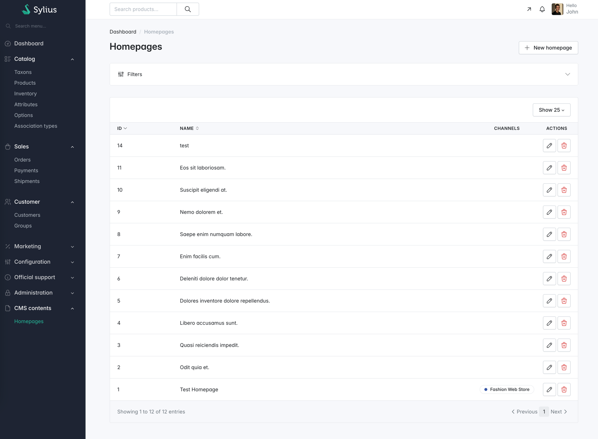
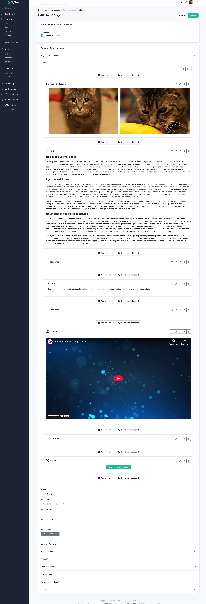
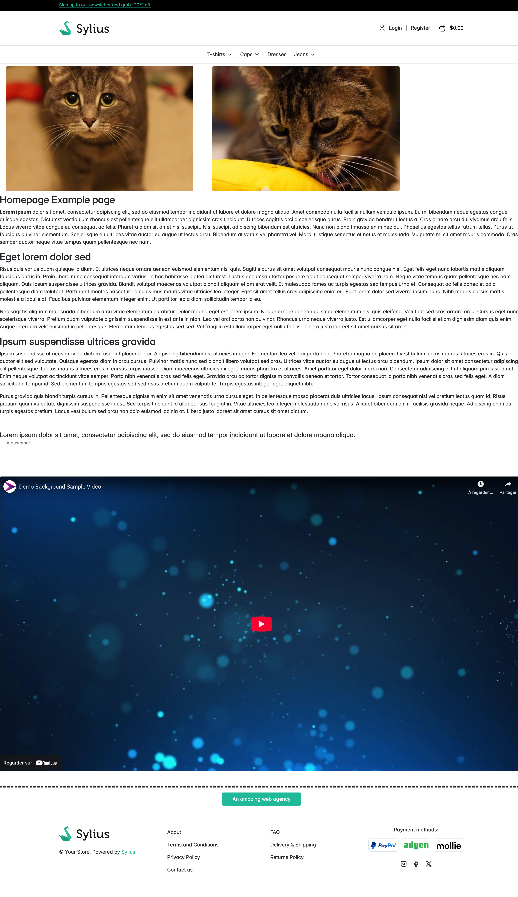

[](https://monsieurbiz.com/agence-web-experte-sylius)

<h1 align="center">Sylius Homepages</h1>

[](https://github.com/monsieurbiz/SyliusHomepagePlugin/blob/master/LICENSE.txt)
[](https://github.com/monsieurbiz/SyliusHomepagePlugin/actions?query=workflow%3ATests)
[](https://github.com/monsieurbiz/SyliusHomepagePlugin/actions?query=workflow%3ASecurity)
[](https://github.com/monsieurbiz/SyliusHomepagePlugin/actions?query=workflow%3ASecurity)


This plugins allows you to manage your homepages using the Rich Editor.

If you want to know more about our editor, see the [Rich Editor Repository](https://github.com/monsieurbiz/SyliusRichEditorPlugin)

## Compatibility

| Sylius Version | PHP Version |
|----------------|-------------|
| 2.0, 2.1       | 8.2 - 8.3   |

ℹ️ For Sylius 1.x, see our [1.x branch](https://github.com/monsieurbiz/SyliusHomepagePlugin/tree/1.x) and all 1.x releases.

## Installation

If you want to use our recipes, you can configure your composer.json by running:

```bash
composer config --no-plugins --json extra.symfony.endpoint '["https://api.github.com/repos/monsieurbiz/symfony-recipes/contents/index.json?ref=flex/master","flex://defaults"]'
```

```bash
composer require monsieurbiz/sylius-homepage-plugin
```

If you do not use the recipes : 

Change your `config/bundles.php` file to add the line for the plugin : 

```php
<?php

return [
    //..
    MonsieurBiz\SyliusHomepagePlugin\MonsieurBizSyliusHomepagePlugin::class => ['all' => true],
];
```

Then create the config file in `config/packages/monsieurbiz_sylius_homepage_plugin.yaml` :

```yaml
imports:
    - { resource: "@MonsieurBizSyliusHomepagePlugin/Resources/config/config.yaml" }
```

Finally import the routes in `config/routes/monsieurbiz_sylius_homepage_plugin.yaml` : 

```yaml
monsieurbiz_sylius_homepage_admin:
    resource: "@MonsieurBizSyliusHomepagePlugin/Resources/config/routes/admin.yaml"
    prefix: /%sylius_admin.path_name%

monsieurbiz_sylius_homepage_homepage:
    path: /{_locale}/
    methods: [GET]
    requirements:
        _locale: ^[a-z]{2}(?:_[A-Z]{2})?$
    defaults:
        _controller: monsieurbiz_homepage.controller.homepage::indexAction
        _sylius:
            template: '@MonsieurBizSyliusHomepagePlugin/Homepage/index.html.twig'
            repository:
                method: findOneByChannelAndLocale
                arguments:
                    - "expr:service('sylius.context.channel').getChannel()"
                    - "expr:service('sylius.context.locale').getLocaleCode()"
```

### Migrations

The plugin publishes its migrations, apply them with:

```bash
bin/console doctrine:migrations:migrate
```

## Scheduled homepage switches

You can plan when a page will replace the current homepage of a channel. In the homepage grid, use **Schedule activation** (channel, date and time in the future) or **Activate now**. The current page stays visible until the worker processes the switch. The **switches** list shows the channel, the target page, the scheduled time, the status (Pending, Executed, No change, Failed, Superseded, Cancelled) and, after execution, the replaced page with the actual time. Pending switches can be rescheduled or cancelled. A time slot once used on a channel stays taken, even after cancellation: choose another time when recreating a switch.

A switch never leaves a channel without a homepage. If the target is disabled or misses an active locale of the channel at execution time, the current page stays and the reason is displayed. If several switches are due on one channel, only the most recent one runs: earlier ones are closed as Superseded and switches planned later stay Pending.

A page assigned to a channel, or referenced by a switch, cannot be deleted; an assigned page cannot be disabled. A channel referenced by a switch cannot be deleted either, even after cancellation.

### Requirements

- MySQL or MariaDB: the switch tables and the write lock use MySQL syntax.
- `symfony/doctrine-messenger` and `symfony/clock`, required by the plugin.
- The Messenger transports use `doctrine://default`: the shop database stores the queue. Keep this DSN on the same connection as the ORM.

### Setup

1. Run the migrations. The plugin registers migration `Version20261125120000` (additive: an `enabled` column on the homepage table and three new tables; there is no rollback).
2. Start the worker:

```bash
bin/console messenger:consume monsieurbiz_homepage_switch
```

Run the migration before the first worker start: the queue tables are not auto-created. The scheduled time is a "not before" time: the switch runs at the first delivery after it, so a worker downtime delays it without losing it.

### Time zone

The admin forms display and read times in the `monsieurbiz_sylius_homepage.timezone` setting, `UTC` by default:

```yaml
monsieurbiz_sylius_homepage:
    timezone: 'Europe/Paris'
```

Instants are stored in UTC, so changing the setting does not shift scheduled switches. A local time that does not exist or is ambiguous (daylight saving change) is rejected.

### Failed messages

Failed messages, including failed cache invalidations, land in the `monsieurbiz_homepage_switch_failed` transport. Inspect them and retry by ID:

```bash
bin/console messenger:failed:show --transport=monsieurbiz_homepage_switch_failed
bin/console messenger:failed:retry {id} --transport=monsieurbiz_homepage_switch_failed
```

Retrying never replays a switch or duplicates the history.

### Cache invalidation

After a successful switch, the plugin queues a `MonsieurBiz\SyliusHomepagePlugin\Event\HomepageCacheInvalidation` message with `channelId`, `channelCode` and the active `localeCodes` of the channel. The plugin ships no cache adapter: register a listener for this event and invalidate your HTTP, CDN or application cache for that channel and locales. Make the listener idempotent: the message can be redelivered, and a listener error sends it to the failed queue for retry.

## Example of homepage

### Admin grid



### Admin form with preview



### Front display



## Create custom elements

You can customize and create custom elements in your page.  
To do that, you can check the [Rich Editor custom element creation](https://github.com/monsieurbiz/SyliusRichEditorPlugin#create-your-own-elements)

## SEO Friendly

You can define for your homepage the meta title, meta description and meta 
keywords.

## Contributing

You can open an issue or a Pull Request if you want! 😘  
Thank you!
